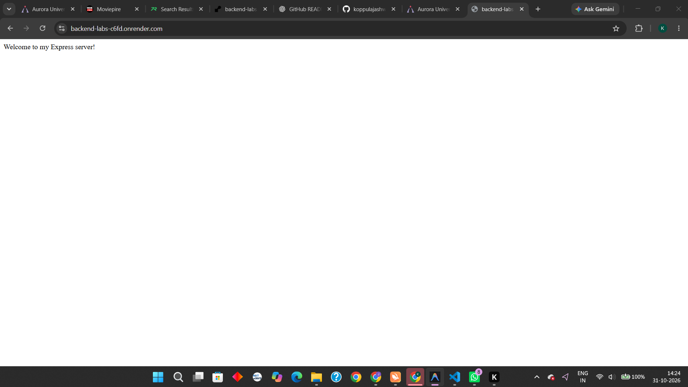
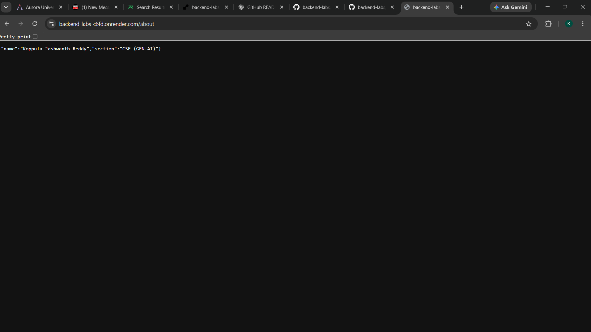
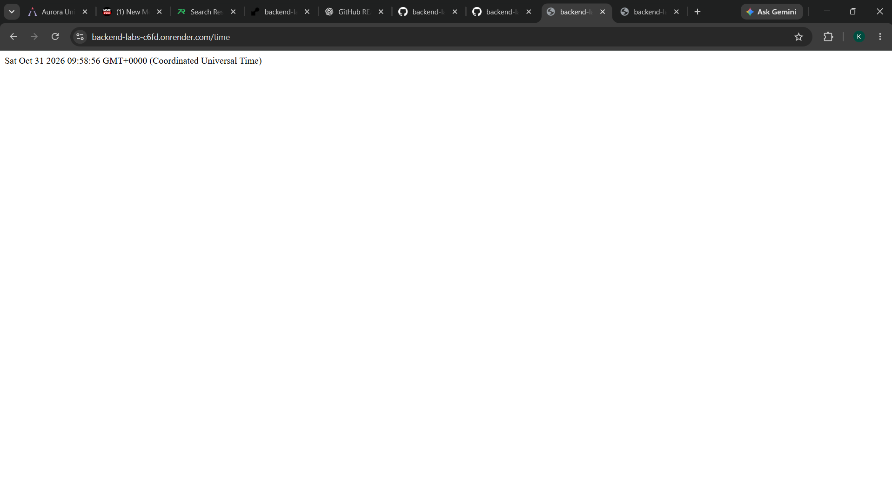

# Lab 1: Node.js and Express server

**Name:** YOUR NAME · **Registration number:** YOUR REG NO · **Section:** YOUR SECTION

**Live link:** PASTE PUBLIC URL HERE (or explain why it could not be deployed and add Postman screenshots)

## How to run

```bash
cd lab-01
npm install        # installs express into node_modules
npm start          # Express server on http://localhost:3000
npm run start:http # (optional) plain http module version
```

Environment variables: none required. `PORT` is optional (defaults to 3000).

## Endpoints

| Method | Path     | Description                          | Status |
| ------ | -------- | ------------------------------------ | ------ |
| GET    | `/`      | Welcome text                         | 200    |
| GET    | `/about` | JSON with name and section           | 200    |
| GET    | `/time`  | Current date and time (`new Date()`) | 200    |
| GET    | any other| 404 message for unknown paths        | 404    |

## package.json fields

- **name** – project name; **version** – current version (semver)
- **description** – short summary; **main** – entry file
- **scripts** – shortcuts run with `npm run <name>` (`npm start`)
- **keywords / author / license** – metadata
- **dependencies** – packages the app needs at runtime (express)

## Screenshots

Take these after running the server and save them in `screenshots/`:






## Status codes observed

| Route      | Status |
| ---------- | ------ |
| `/`        | 200    |
| `/about`   | 200    |
| `/time`    | 200    |
| `/unknown` | 404    |

## Viva notes

- **package.json vs node_modules:** package.json describes the project and lists dependencies; node_modules holds the actual downloaded packages (and is not committed).
- **app.listen:** binds the app to a port and starts accepting HTTP requests.
- **request / response:** `req` is the incoming HTTP request (URL, method, headers, body); `res` is what the server sends back (status, headers, body).

## Notes: problems faced and how I solved them

Write your own notes here.
