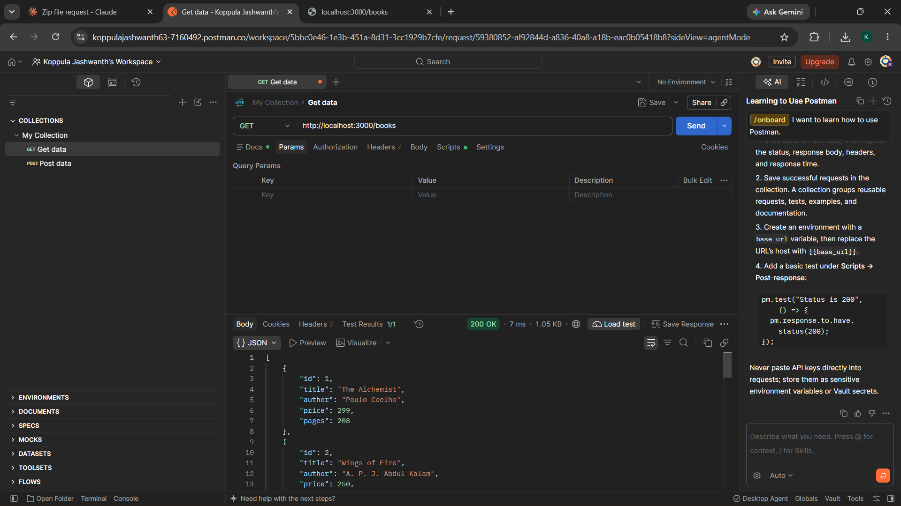
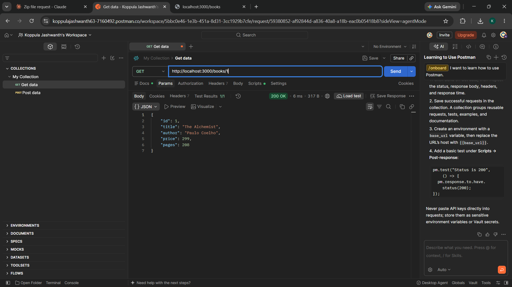
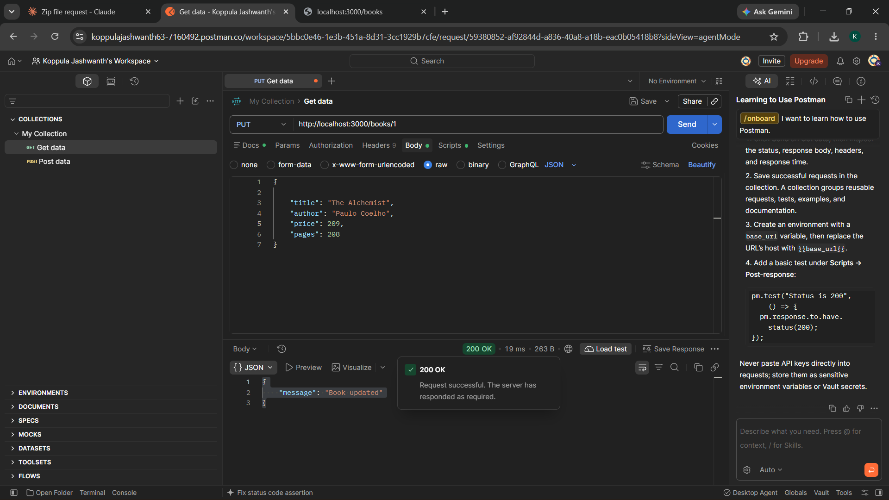
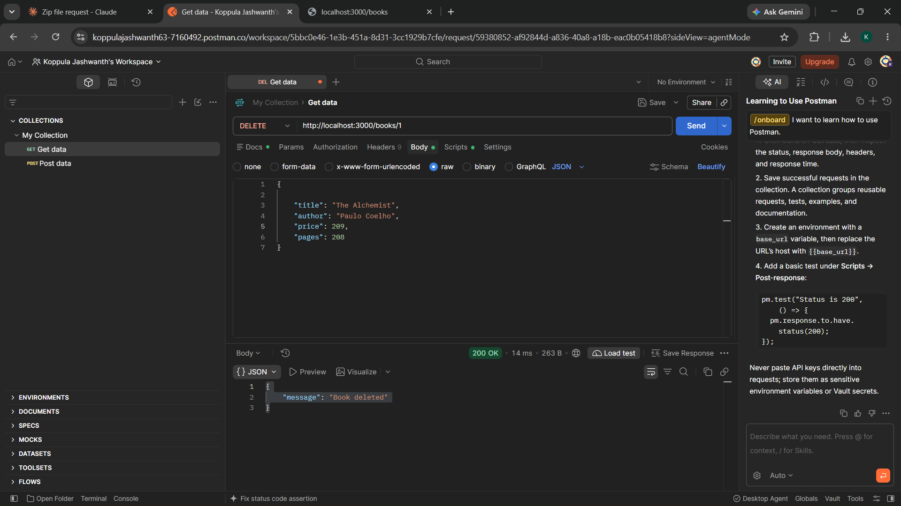
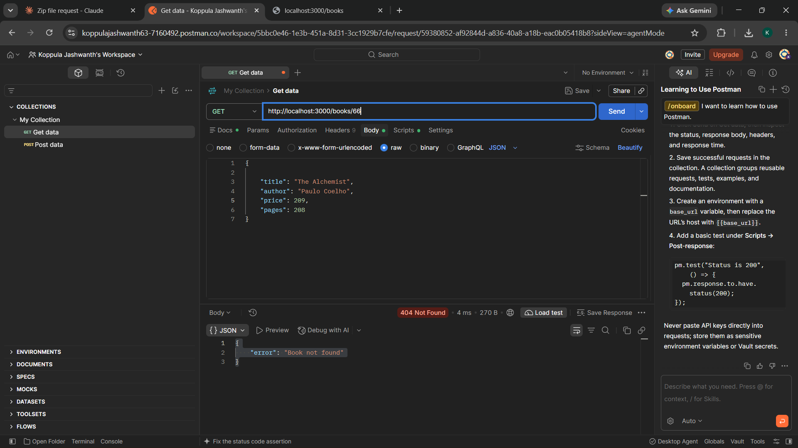
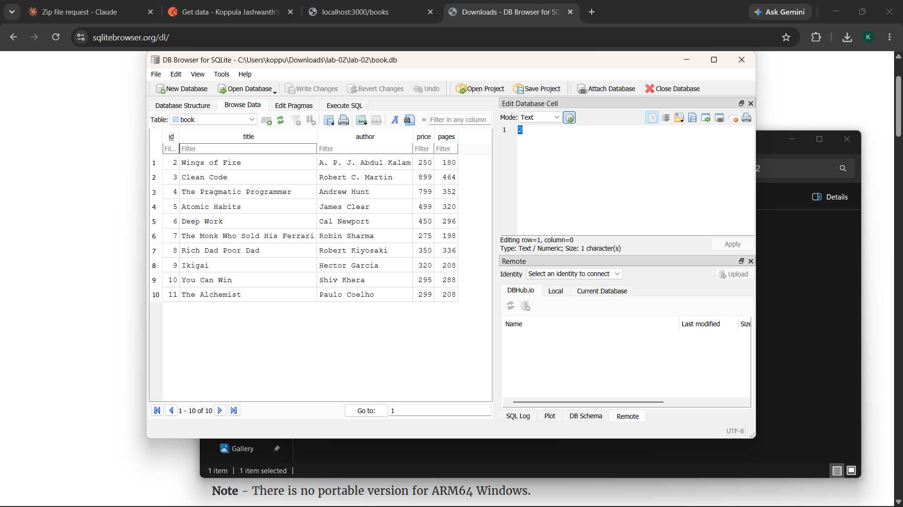

# Lab 2: SQLite database and CRUD routes

**Name:** Koppula Jashwanth Reddy · **Registration number:** 252U1R9072 · **Section:** CSE (GEN.AI)

**Live link:** Not deployed. The Render service for this repository hosts Lab 1; this lab runs locally with SQLite. Postman screenshots for every endpoint are below.

## Objective

Connect an Express server to a SQLite database and expose CRUD operations over HTTP.

## How to run

```bash
cd lab-02
npm install
cp .env.example .env     # optional: set PORT (default 3000)
npm run dev              # nodemon, restarts on every change
# or: npm start
```

Environment variables (no real values are committed):

| Variable | Purpose | Default |
| --- | --- | --- |
| `PORT` | Port the server listens on | `3000` |

## Database

File: `book.db`, table `book(id INTEGER PRIMARY KEY, title TEXT, author TEXT, price INTEGER, pages INTEGER)` with 10 seed rows.
To recreate it from scratch:

```bash
rm book.db
sqlite3 book.db < schema.sql
```

Compare API results with the CLI: `sqlite3 book.db "SELECT * FROM book;"`

## Endpoints

| Method | Path | Description | Success | Errors |
| --- | --- | --- | --- | --- |
| GET | `/books/` | List all books | 200 | 500 |
| GET | `/books/:bookId/` | Get one book | 200 | 400, 404 |
| POST | `/books/` | Add a book (JSON body: title, author, price, pages) | 201 | 400 |
| PUT | `/books/:bookId/` | Update all fields of an existing book | 200 | 400, 404 |
| DELETE | `/books/:bookId/` | Delete a book | 200 | 400, 404 |

Sample body for POST / PUT:

```json
{ "title": "Dune", "author": "Frank Herbert", "price": 550, "pages": 412 }
```

All queries use `?` placeholders; user input is never joined into SQL strings.

## Screenshots

Add your Postman and database screenshots in `screenshots/` and reference them like this:









## Notes: problems faced and how I solved them

- (Write your own notes here.)

## Viva answers (for revision)

- **Why await the database call?** DB operations are asynchronous and return Promises. Without `await`, the code continues before the result is ready and you would get a pending Promise instead of data.
- **SQL injection and placeholders:** Injection is when user input changes the meaning of a query (e.g. `1 OR 1=1`). With `?` placeholders the SQL is compiled first and values are bound separately as data, so they can never become SQL.
- **PUT vs POST:** POST creates a new resource (server assigns the id). PUT updates/replaces an existing resource at a known URL and is idempotent.
