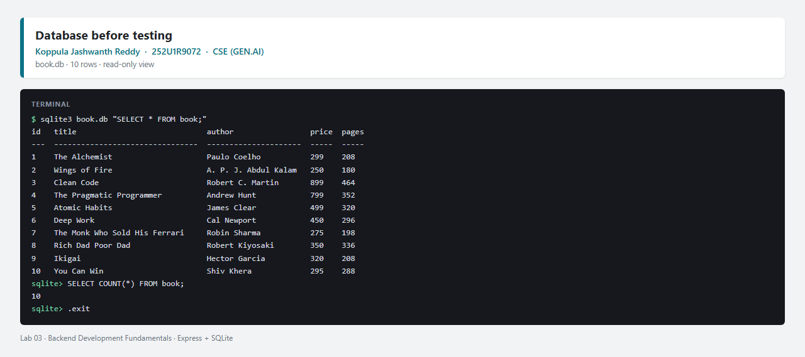
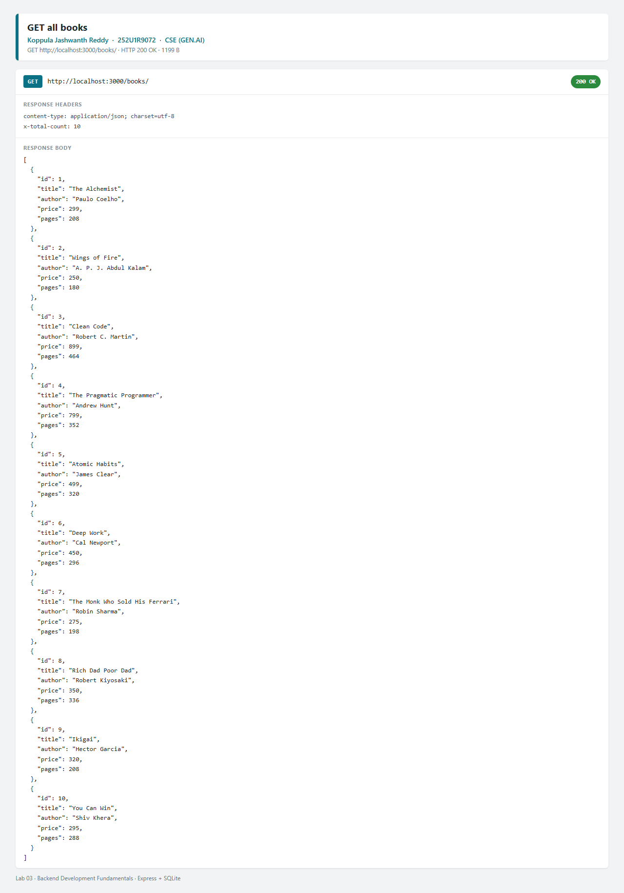
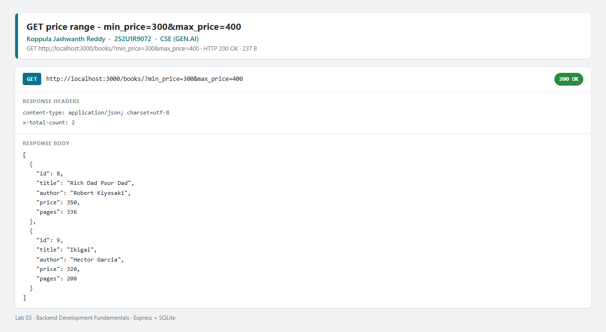
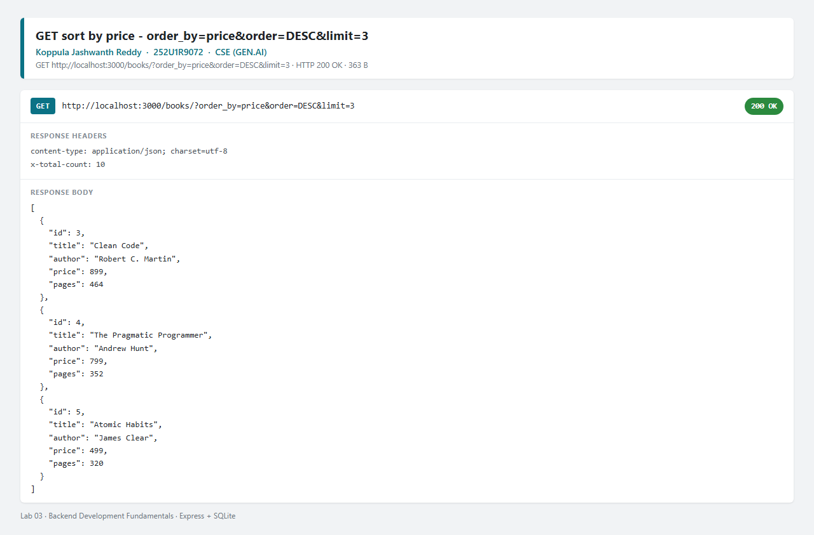
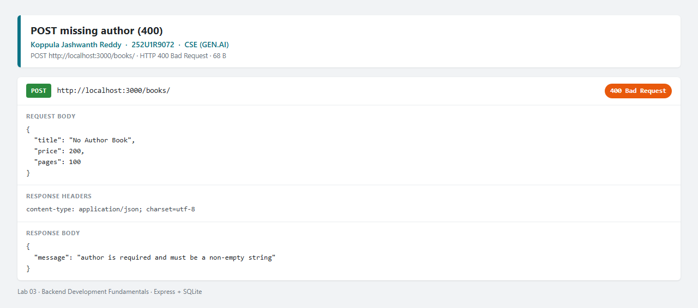
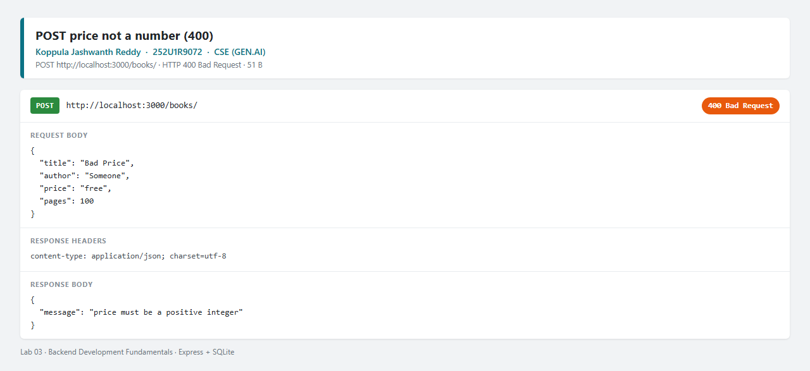
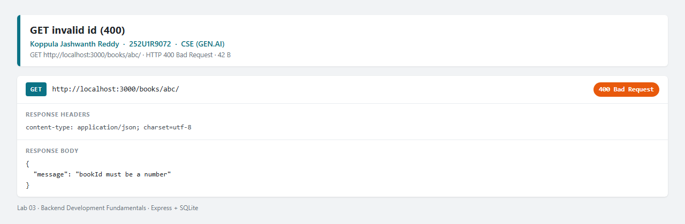
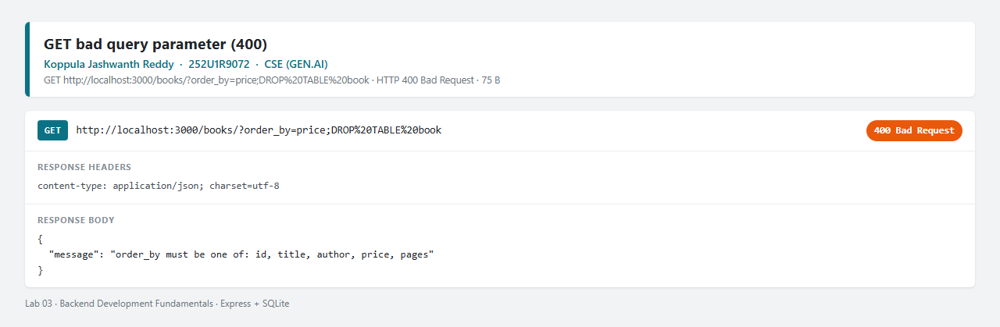
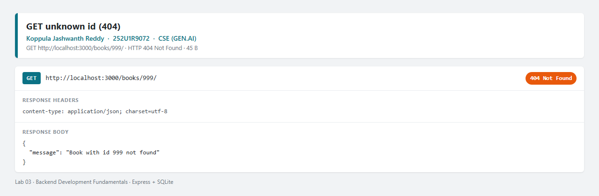
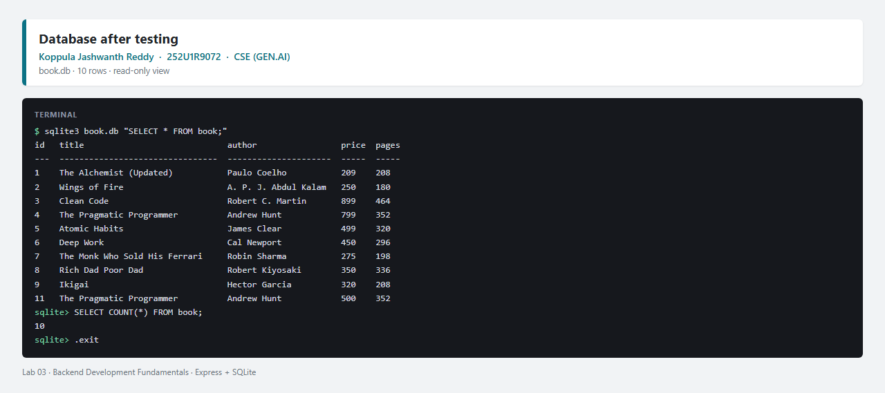

# Lab 3: REST API, query parameters, validation, debugging

**Koppula Jashwanth Reddy** · Registration number **252U1R9072** · Section **CSE (GEN.AI)**

**Live link:** https://bdf-lab-03-jashwanth.vercel.app/

Course: Backend Development Fundamentals — Year II Term II — Aurora
Faculty: Joel Prashanth D

> The live server stores its database in `/tmp`, the only writable folder on Vercel. Creating, updating and deleting books works, but the data returns to the 10 starting rows when the server restarts.

## Objective

Turn the Lab 2 CRUD routes into a clean REST API: nouns in the paths, HTTP methods for the actions, search, sorting, pagination and price filters in `GET /books/`, strict validation of input, the correct status code for every case, and one consistent JSON shape for every response.

## Technologies used

- Node.js (v18 or later)
- Express.js 4
- SQLite (`sqlite` and `sqlite3` packages)
- nodemon (development only)
- newman (runs the Postman collection from the CLI)

## Project structure

```text
lab-03/
├── api/
│   └── index.js                  # Vercel entry point (imports the Express app)
├── scripts/
│   └── reset-db.js               # npm run db:reset — rebuilds book.db from schema.sql
├── screenshots/
│   ├── bad-query-param.png
│   ├── db-after.png
│   ├── db-before.png
│   ├── delete.png
│   ├── errors-404.png
│   ├── get-all.png
│   ├── get-one.png
│   ├── invalid-id.png
│   ├── newman-cli.png
│   ├── post-bad-price.png
│   ├── post-missing-author.png
│   ├── post.png
│   ├── put.png
│   ├── query-filter-sort.png
│   ├── query-pagination.png
│   ├── query-price-filter.png
│   └── query-search.png
├── .gitignore
├── app.js                        # Express app: routes, validation, error handler
├── db.js                         # opens book.db and creates the schema on first run
├── index.js                      # local entry point (starts the HTTP server)
├── package.json
├── package-lock.json
├── postman_collection.json       # 14 success and failure requests
├── schema.sql                    # table definition and the 10 starting rows
├── vercel.json                   # sends all requests to api/index.js
└── README.md
```

## How to run

Open a terminal in this `lab-03` folder:

```bash
npm install
npm run dev          # nodemon, restarts on every change
# or: npm start      # plain node
```

The terminal prints:

```text
Lab 3 API running at http://localhost:3000/books/
```

Open <http://localhost:3000/> to see the list of endpoints.

### Database

`book.db` is generated, not committed. `db.js` creates it from `schema.sql` on the first start, so there is no separate setup step. To rebuild it with the 10 starting rows at any time:

```bash
npm run db:reset
```

Inspect the same rows the API returns:

```bash
sqlite3 book.db "SELECT * FROM book;"
```

### Environment variables

| Variable | Required | Description |
|---|---|---|
| `PORT` | No | Port the server listens on. Falls back to `3000` when it is not set. |
| `DB_FILE` | No | Path to the SQLite file. Defaults to `./book.db`. |

No database password, API key or `.env` file is used in this lab. The app reads real environment variables (there is no dotenv loader), so on Windows PowerShell set them for the session:

```powershell
$env:PORT = 3001
npm start
```

## Endpoints

| Method | Path | Description |
|---|---|---|
| GET | `/` | Lists the available endpoints. |
| GET | `/books/` | Returns books, with optional search, filter, sort and pagination. |
| GET | `/books/:bookId/` | Returns one book by id. |
| POST | `/books/` | Creates a book and returns 201 with the new id. |
| PUT | `/books/:bookId/` | Replaces the details of an existing book. |
| DELETE | `/books/:bookId/` | Deletes a book. |

A list response also sends `X-Total-Count` with the number of rows matching the filters (before `limit`/`offset`), which is useful for pagination.

## Query parameters for `GET /books/`

| Parameter | Default | Description |
|---|---|---|
| `search_q` | empty | Partial, case-insensitive match on the title using `LIKE`. |
| `order_by` | `id` | Column to sort by: `id`, `title`, `author`, `price` or `pages`. |
| `order` | `ASC` | Sort direction: `ASC` or `DESC`. |
| `limit` | `10` | Maximum number of rows returned (1–100). |
| `offset` | `0` | Number of rows skipped, used with `limit` for pages. |
| `min_price` | none | Smallest price to include (integer). |
| `max_price` | none | Largest price to include (integer). |

Examples:

```text
/books/?search_q=habit
/books/?min_price=300&max_price=400&order_by=price&order=DESC
/books/?limit=2&offset=8
```

`order_by` is checked against a fixed list of column names, because a column name cannot be passed as a `?` placeholder. Every value that comes from the user is still sent as a placeholder, never joined into the SQL string.

## Status codes and error messages

Every error uses the same shape: `{ "message": "..." }`.

| Case | Status | Example message |
|---|---|---|
| Invalid `bookId` (not a number) | 400 | `bookId must be a number` |
| Missing or empty `title` | 400 | `title is required and must be a non-empty string` |
| Missing or empty `author` | 400 | `author is required and must be a non-empty string` |
| `price` not a positive whole number | 400 | `price must be a positive integer` |
| `pages` missing, zero, negative or decimal | 400 | `pages must be a positive integer` |
| Bad `order_by`, `order`, `limit`, `offset`, `min_price` or `max_price` | 400 | `order must be ASC or DESC` |
| `min_price` greater than `max_price` | 400 | `min_price cannot be greater than max_price` |
| Body is not valid JSON | 400 | `Invalid JSON body` |
| Book does not exist | 404 | `Book with id 999 not found` |
| Unknown route | 404 | `Route not found: GET /nope` |
| Successful create | 201 | `Book created` + `bookId` |
| Successful update or delete | 200 | `Book updated` / `Book deleted` |

## Debugging exercise

The four faults from the broken version handed out for this lab, and the fix present in this project:

| Symptom | Cause | Fix in this project |
|---|---|---|
| `Error: listen EADDRINUSE :::3000` on start | Another process was already holding port 3000 (during this lab, an older server from another folder was still running). | Stop the other process, or start with `PORT=3001 npm start`. `index.js` reads `process.env.PORT` and prints a clear message instead of crashing. |
| `Error: Cannot find module './routes/books'` | The import path did not match the file layout. | `index.js` imports `./db` and `./app`, and `api/index.js` imports `../db` and `../app` — the files that actually exist. |
| `SQLITE_ERROR: no such table: books` | The query used `books` while the table is created as `book`. | Every query uses the same `book` table name as `schema.sql`. |
| Response body is empty or `undefined` in the handler | The database call was used without `await`. | Every `db.all()`, `db.get()` and `db.run()` call is awaited before its result is used. |

Two more problems hit while building this lab:

- `EBUSY: resource busy or locked` when running `npm run db:reset` — a server process still had `book.db` open. Stop the server first, then reset.
- A decimal `price` such as `10.5` was accepted while the column is `INTEGER` and `min_price` rejected decimals. Validation now requires a positive integer for `price`, so the API and the schema agree.

## Testing

All 14 cases are in `postman_collection.json`: import it into Postman and press Send on each request, or run the whole list from the terminal:

```bash
npm run test:postman
```

That command starts the API on port 3100 with a throwaway database, runs all 14 requests with newman, then stops the server and deletes the database. Your `book.db` and port 3000 are not touched.

Result of the last run: **14 requests, 29 assertions, 0 failures.**

| # | Request | Expected |
|---|---|---|
| 01 | `GET /books/` | 200, 10 books, `X-Total-Count: 10` |
| 02 | `GET /books/?search_q=habit` | 200, only titles containing "habit" |
| 03 | `GET /books/?min_price=300&max_price=400` | 200, every price in the range |
| 04 | `GET /books/?order_by=price&order=DESC&limit=3` | 200, three most expensive first |
| 05 | `GET /books/?limit=2&offset=8` | 200, the last two rows |
| 06 | `GET /books/1/` | 200, one book |
| 07 | `POST /books/` valid body | 201, new id |
| 08 | `POST /books/` without `author` | 400, message names `author` |
| 09 | `POST /books/` with `"price": "free"` | 400, message names `price` |
| 10 | `PUT /books/1/` valid body | 200, updated |
| 11 | `DELETE /books/10/` | 200, deleted |
| 12 | `GET /books/999/` | 404, `Book with id 999 not found` |
| 13 | `GET /books/abc/` | 400, `bookId must be a number` |
| 14 | `GET /books/?order_by=price;DROP%20TABLE%20book` | 400, `order_by must be one of ...` |

## Screenshots

Every request below was sent to the running server using the requests in `postman_collection.json`. The last image is the full CLI run.

### Database before testing

Table structure and the 10 starting rows, read with the SQLite CLI.



### GET /books/ — default query

Returns the first 10 books with status 200.



### Search — `?search_q=habit`

Partial title match with `LIKE`; only titles containing "habit" come back.


### Price filter — `?min_price=300&max_price=400`

Returns only books priced between 300 and 400.



### Sort — `?order_by=price&order=DESC&limit=3`

The three most expensive books, highest first.



### Pagination — `?limit=2&offset=8`

Skips the first eight rows and returns two.


### GET /books/1/ — one book

Returns a single book with status 200.


### POST /books/ — create

Request body and the 201 response with the new book id.


### POST /books/ — missing author

Returns 400 with a message naming the missing field.



### POST /books/ — price is not a number

A string in `price` is rejected with 400.



### PUT /books/1/ — update

Request body and the 200 response after replacing the fields.


### DELETE /books/10/ — delete

Returns 200 after removing the row.


### GET /books/abc/ — invalid id

A non-numeric id returns 400, not 404.



### GET /books/ — bad query parameter

An `order_by` value that is not a column name returns 400.



### GET /books/999/ — not found

A missing book returns 404 with the same JSON shape.



### Database after testing

Row 1 is updated, row 10 is deleted and the book created with POST has id 11.



### Full Postman collection run in the CLI

`npm run test:postman` (newman) — 14 requests, 29 assertions, 0 failures.


## Viva answers (for revision)

- **Query parameter vs path parameter:** a path parameter identifies a resource (`/books/3/` — which book), while a query parameter modifies how the collection is returned (`?limit=5&order=DESC` — how the list is shaped). Path parameters are part of the route; query parameters are optional and have defaults.
- **What "stateless" means:** each request carries everything the server needs (URL, method, body, headers/token). The server does not remember the previous request between calls, so any instance can serve any request. That is why authentication is sent as a token on every request rather than as a server-side session.
- **Bad input vs missing record:** bad input is **400 Bad Request** (the client sent something invalid, e.g. `price: "free"`, so retrying the same request will not help). A missing record is **404 Not Found** (the request was valid but no book has that id).
- **Why `await`:** `db.get()`/`db.all()`/`db.run()` return promises. Without `await`, the handler sends a pending promise instead of the rows, and the response is empty or wrong.
- **SQL injection and placeholders:** with `?` placeholders the SQL text is compiled first and the values are bound separately as data, so `"1 OR 1=1"` stays a string. Column names cannot be bound, so `order_by` is checked against a whitelist.
