# Lab 3: REST API, query parameters, validation, debugging

**Koppula Jashwanth Reddy** · Registration number **252U1R9072** · Section **CSE (GEN.AI)**

**Live link:** Not deployed. The Render service for this repository hosts Lab 1, and this lab writes to a local SQLite file, so it is run locally. Every endpoint, including the failure cases, is shown in the [screenshots](#screenshots) below.

Course: Backend Development Fundamentals — Year II Term II — Aurora

## Objective

Turn the Lab 2 CRUD routes into a clean REST API: plural nouns in the paths, HTTP methods for the actions, search / sort / filter / pagination on `GET /books/`, strict validation of the request body, one JSON error shape, and the correct status code for every case. The lab also covers debugging the four common faults (port conflict, wrong import path, table-name typo, missing `await`).

## Technologies used

- Node.js (v18 or later)
- Express 4
- SQLite through the `sqlite` and `sqlite3` packages
- nodemon (development only)
- Postman / newman (the same collection is used for both)

## Project structure

```text
lab-03/
├── app.js                       # Express app: routes, validation, error handler
├── db.js                        # opens book.db (shared by index.js and the scripts)
├── index.js                     # entry point: opens the DB, starts the server, graceful shutdown
├── schema.sql                   # book table + 10 seed rows
├── scripts/
│   └── reset-db.js              # npm run db:reset — rebuilds book.db from schema.sql
├── postman/
│   ├── Lab-03.postman_collection.json
│   └── Lab-03.postman_environment.json
├── screenshots/                 # proof of every success and failure case
├── .env.example
├── .gitignore                   # node_modules, .env, *.db
├── package.json
└── README.md
```

## How to run

Open a terminal in this `lab-03` folder:

```bash
npm install
npm start            # or: npm run dev  (nodemon)
```

On the first run the server creates `book.db` from `schema.sql` (10 seed rows), so there is no separate setup step.

The terminal prints:

```text
Lab 3 API running at http://localhost:3000/books/
```

### Environment variables

| Variable | Required | Default | Description |
| --- | --- | --- | --- |
| `PORT` | No | `3000` | Port the HTTP server listens on. |
| `DB_FILE` | No | `./book.db` | Path to the SQLite database file. Handy for a throwaway test database. |

No passwords or API keys are used in this lab. The app reads real environment variables; there is no dotenv loader, so on Windows PowerShell set them for the session before starting:

```powershell
$env:PORT = 3001
npm start
```

`.env.example` documents the two variables and contains no real values (`.env` is git-ignored).

## Database

`book.db` is generated, not committed (see `.gitignore`). It is created from `schema.sql` automatically on the first start, or when `DB_FILE` points at an empty file. Rebuild it with the seed rows at any time with:

```bash
npm run db:reset
```

Table:

```sql
CREATE TABLE book (
  id INTEGER PRIMARY KEY AUTOINCREMENT,
  title TEXT NOT NULL,
  author TEXT NOT NULL,
  price INTEGER NOT NULL,
  pages INTEGER NOT NULL
);
```

It is seeded with 10 books. Inspect the same rows the API returns with:

```bash
sqlite3 book.db "SELECT * FROM book;"
```

## Endpoints

| Method | Path | Description | Success |
| --- | --- | --- | --- |
| GET | `/books/` | List books with search, price filter, sorting and pagination. | 200 |
| GET | `/books/:bookId/` | Return one book by id. | 200 |
| POST | `/books/` | Create a book from a JSON body. | 201 |
| PUT | `/books/:bookId/` | Replace all fields of an existing book. | 200 |
| DELETE | `/books/:bookId/` | Delete a book. | 200 |

Every error uses the same shape, for example `{ "message": "Book with id 99 not found" }`. A list response also sends `X-Total-Count` with the number of rows matching the filters (before `limit`/`offset`), which is useful for pagination.

### Query parameters for `GET /books/`

| Parameter | Default | Validation | Description |
| --- | --- | --- | --- |
| `search_q` | empty | any text | Partial, case-insensitive match on `title` with `LIKE`. |
| `order_by` | `id` | `id`, `title`, `author`, `price`, `pages` | Column used for sorting. |
| `order` | `ASC` | `ASC` or `DESC` | Sort direction. |
| `limit` | `10` | integer 1–100 | Maximum rows returned. |
| `offset` | `0` | integer ≥ 0 | Rows skipped, used with `limit` for pages. |
| `min_price` | none | integer ≥ 0 | Lower bound of the price range. |
| `max_price` | none | integer ≥ 0 | Upper bound of the price range. |

Examples:

```text
/books/?search_q=clean
/books/?min_price=300&max_price=500&order_by=price&order=DESC
/books/?limit=5&offset=5
```

`order_by` is checked against a fixed list, because a column name cannot be bound as a `?` placeholder. Every user value is still sent to SQLite as a bound parameter; SQL is never built by joining input into the string.

### Status codes and error messages

| Case | Status | Example message |
| --- | --- | --- |
| Book created | 201 | `Book created` + `bookId` |
| Book updated / deleted | 200 | `Book updated` / `Book deleted` |
| `bookId` is not a number | 400 | `bookId must be a number` |
| `title` missing or empty | 400 | `title is required and must be a non-empty string` |
| `author` missing or empty | 400 | `author is required and must be a non-empty string` |
| `price` not a positive whole number | 400 | `price must be a positive integer` |
| `pages` not a positive whole number | 400 | `pages must be a positive integer` |
| Bad `order_by`, `order`, `limit`, `offset`, `min_price`, `max_price` | 400 | `order must be ASC or DESC` |
| `min_price` greater than `max_price` | 400 | `min_price cannot be greater than max_price` |
| Body is not valid JSON | 400 | `Invalid JSON body` |
| Book does not exist | 404 | `Book with id 999 not found` |
| Unknown route | 404 | `Route not found: GET /nope` |
| Anything unexpected | 500 | `Internal server error` |

## Debugging exercise

The four faults from the broken version handed out for this lab, and the fix present in this project:

| Symptom | Cause | Fix in this project |
| --- | --- | --- |
| `Error: listen EADDRINUSE :::3000` on start | Another process was already holding port 3000 (during this lab, an older server from another folder was still running). | Stop the other process, or start with `PORT=3001 npm start`. `index.js` reads `process.env.PORT` and prints a clear message instead of crashing. |
| `Error: Cannot find module './routes/books'` | The import path did not match the file layout. | The entry file imports `./db` and `./app`, which are the files that actually exist. |
| `SQLITE_ERROR: no such table: books` | The query used `books` while the table is created as `book`. | Every query uses the same `book` table name as `schema.sql`. |
| Response body is empty or `undefined` | The database call was used without `await`. | Every `db.all()`, `db.get()` and `db.run()` call is awaited before its result is used. |

Two more problems hit while building this lab:

- `EBUSY: resource busy or locked` when running `npm run db:reset` — a server process still had `book.db` open. Stop the server first, then reset.
- A decimal `price` such as `10.5` was accepted while the column is `INTEGER` and `min_price` rejected decimals. Validation now requires a positive integer for `price`, so the API and the schema agree.

## Testing with Postman / newman

Import `postman/Lab-03.postman_collection.json` and `postman/Lab-03.postman_environment.json` into Postman, start the server, and run the requests top to bottom. The collection saves the new id as `{{newBookId}}` after `POST`, so `PUT` and `DELETE` act on the book that was just created.

The same collection runs from the command line with newman (installed as a dev dependency):

```bash
npm start                          # terminal 1
npm run test:postman               # terminal 2
```

Result of the last run: **25 requests, 48 assertions, 0 failures.**

| # | Request | Expected |
| --- | --- | --- |
| 1 | `GET /books/` | 200, 10 rows, `X-Total-Count: 10` |
| 2 | `GET /books/?search_q=clean` | 200, titles contain "clean" |
| 3 | `GET /books/?order_by=price&order=DESC&limit=3` | 200, 3 most expensive first |
| 4 | `GET /books/?min_price=300&max_price=500` | 200, every price inside the range |
| 5 | `GET /books/?limit=5&offset=5` | 200, second page of 5 |
| 6 | `GET /books/1/` | 200, one book |
| 7 | `POST /books/` valid body | 201, `{ message, bookId }` |
| 8 | `GET /books/{{newBookId}}/` | 200, the created book |
| 9 | `PUT /books/{{newBookId}}/` | 200, `Book updated` |
| 10 | `GET /books/{{newBookId}}/` | 200, all fields replaced |
| 11 | `DELETE /books/{{newBookId}}/` | 200, `Book deleted` |
| 12 | `GET /books/{{newBookId}}/` | 404 after delete |
| 13 | `GET /books/999999/` | 404 |
| 14 | `GET /books/abc/` | 400, `bookId must be a number` |
| 15 | `POST /books/` without `title` | 400, message names `title` |
| 16 | `POST /books/` with `"price": "five hundred"` | 400, message names `price` |
| 17 | `POST /books/` with `{}` | 400 |
| 18 | `PUT /books/999999/` valid body | 404 |
| 19 | `DELETE /books/999999/` | 404 |
| 20 | `GET /books/?order_by=password` | 400, message lists allowed columns |
| 21 | `GET /books/?order=sideways` | 400, `order must be ASC or DESC` |
| 22 | `GET /books/?limit=1000` | 400, maximum is 100 |
| 23 | `GET /books/?min_price=900&max_price=100` | 400, range problem |
| 24 | `GET /nope` | 404, route-not-found JSON |
| 25 | `POST /books/` with malformed JSON | 400, `Invalid JSON body` |

## Screenshots

Each image below is a real request/response from the server running at `http://localhost:3000`, using the requests in the Postman collection. The full CLI run is shown last.

### `GET /books/` — default query

Returns the first 10 books with status 200 and `X-Total-Count: 10`.

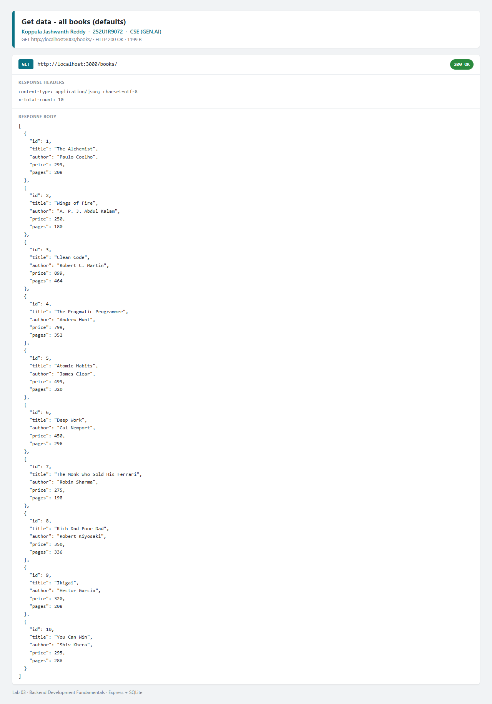

### Search — `?search_q=clean`

Partial title match with `LIKE`; only titles containing "clean" are returned.

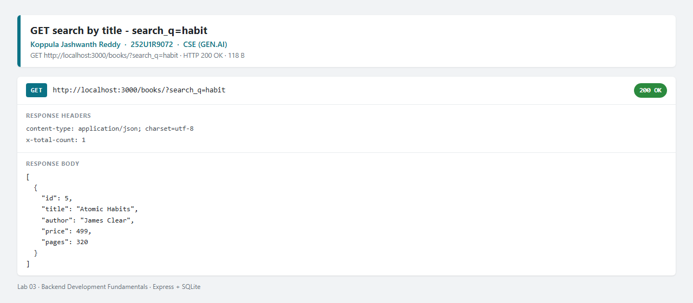

### Sort — `?order_by=price&order=DESC&limit=3`

The three most expensive books, highest first.

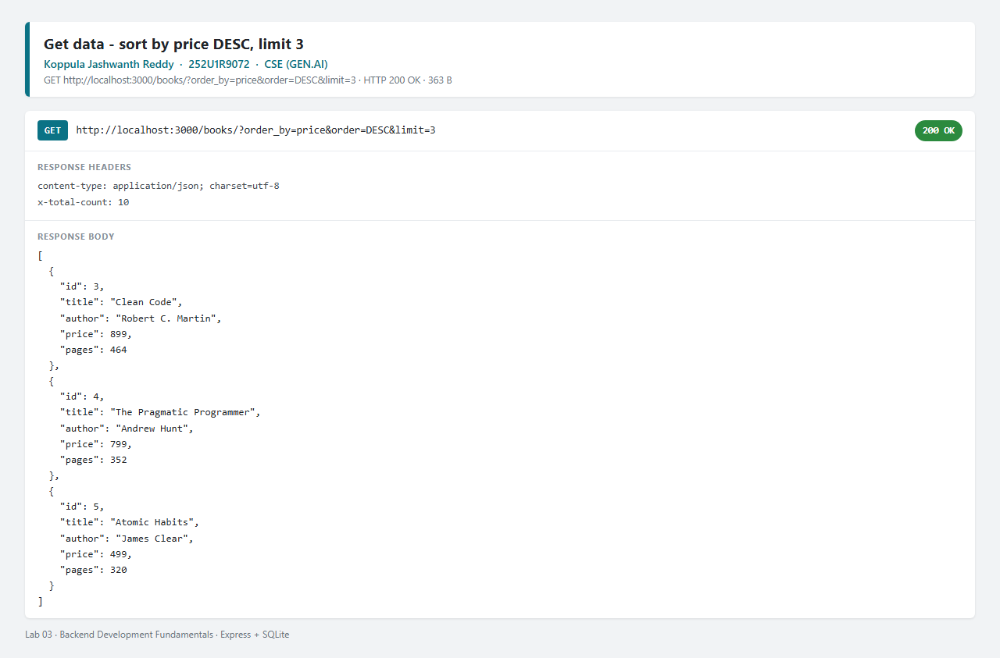

### Price filter — `?min_price=300&max_price=500`

Only books inside the price range are returned.

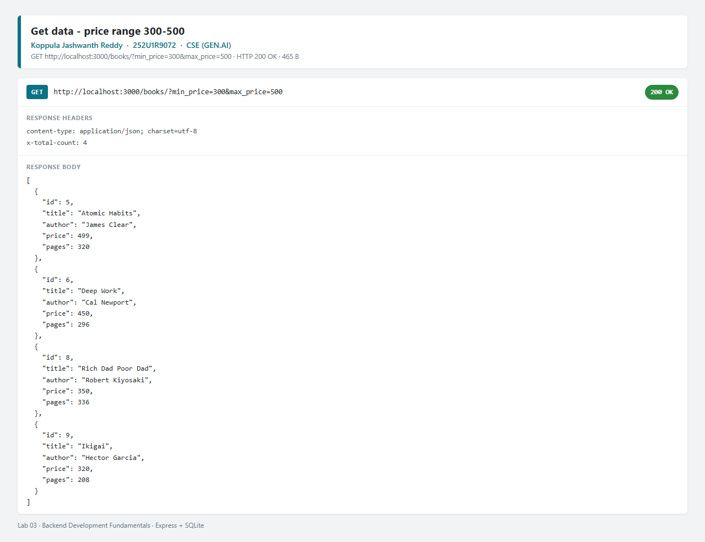

### Pagination — `?limit=5&offset=5`

Skips the first five rows and returns the next five.

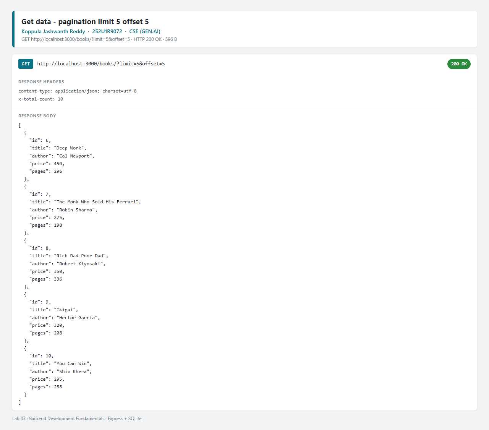

### `GET /books/1/` — one book

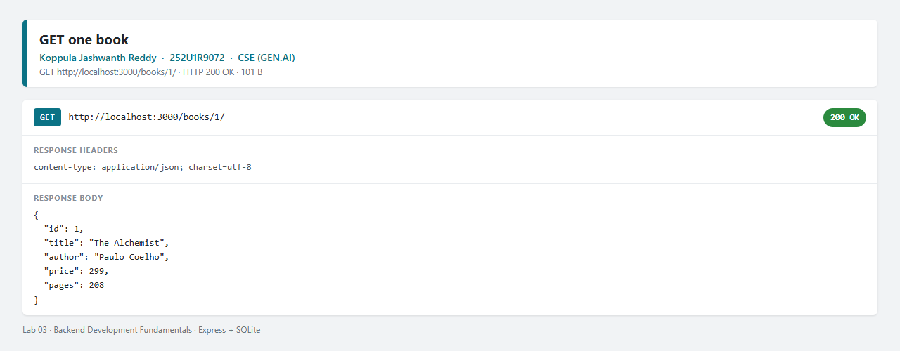

### `POST /books/` — create (201)

Request body and the 201 response with the new `bookId`.

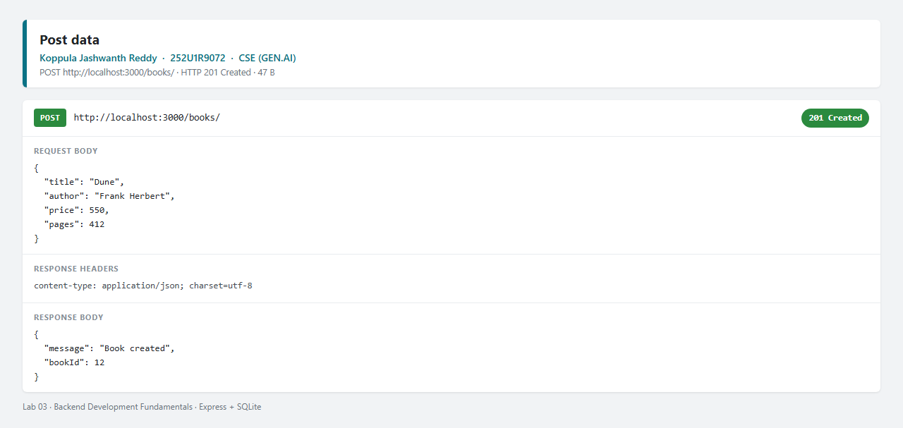

### `PUT /books/1/` — update (200)

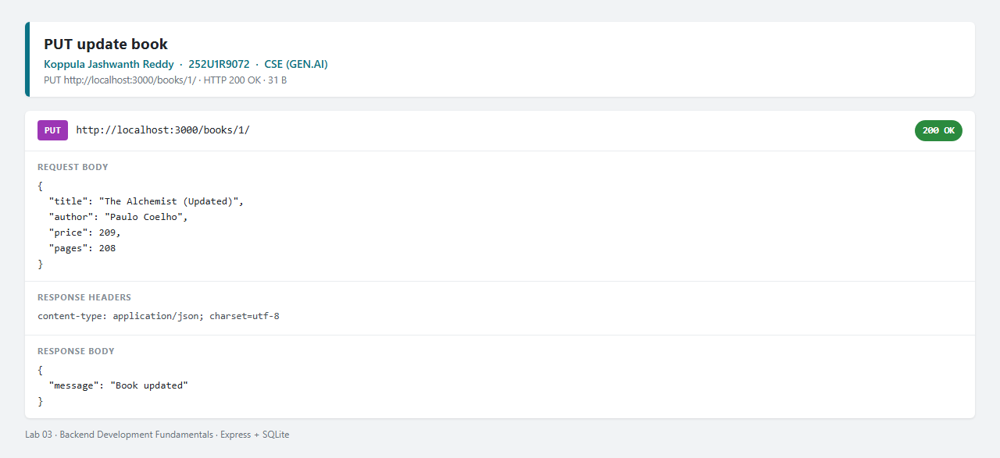

### `DELETE /books/:bookId/` — delete (200)

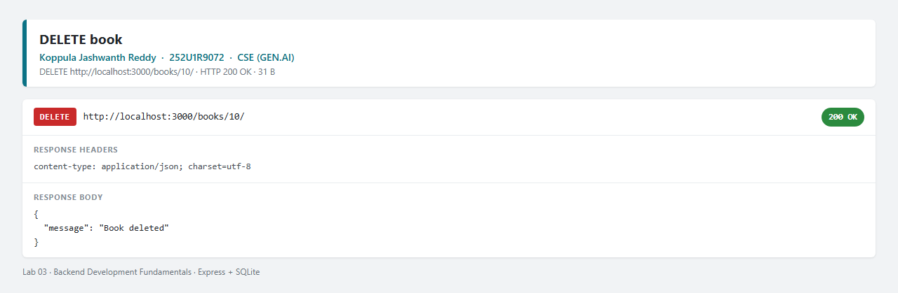

### Failure case — non-numeric price (400)

A string in `price` is rejected with 400 and a clear message.

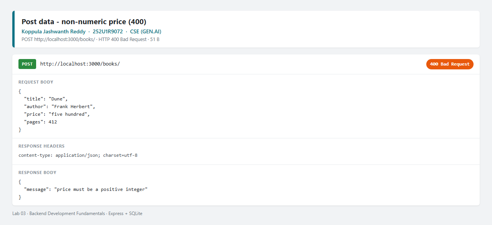

### Failure case — missing book (404)

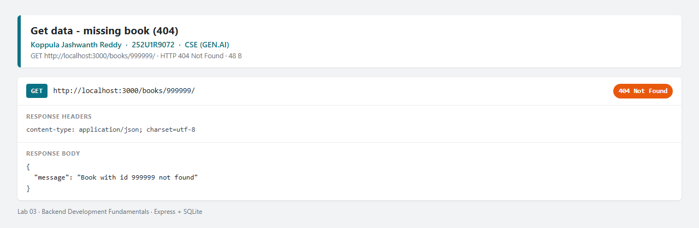

### Database after the requests

`sqlite3 book.db "SELECT * FROM book;"` shows the seed rows plus the book created with `POST`.

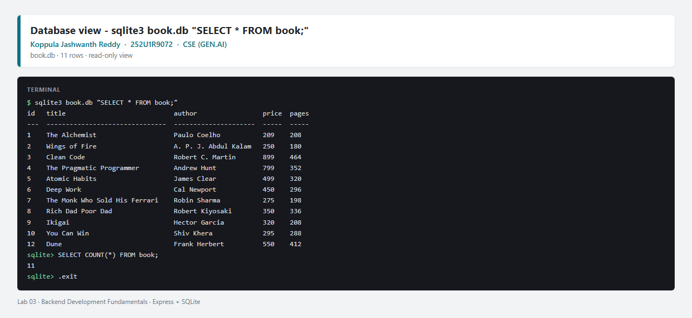

### Full Postman collection run in the CLI

`npm run test:postman` (newman) — 25 requests, 48 assertions, 0 failures.

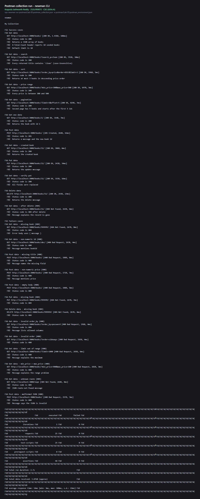

## Viva answers (for revision)

- **Query parameter vs path parameter:** a path parameter identifies a resource (`/books/3/` — which book), while a query parameter modifies how the collection is returned (`?limit=5&order=DESC` — how the list is shaped). Path parameters are part of the route; query parameters are optional and have defaults.
- **What "stateless" means:** each request carries everything the server needs (URL, method, body, headers/token). The server does not remember the previous request between calls, so any instance can serve any request. That is why authentication is sent as a token on every request rather than as a server-side session.
- **Bad input vs missing record:** bad input is **400 Bad Request** (the client sent something invalid, e.g. `price: "free"`, so retrying the same request will not help). A missing record is **404 Not Found** (the request was valid but no book has that id).
- **Why `await`:** `db.get()`/`db.all()`/`db.run()` return promises. Without `await`, the handler sends a pending promise instead of the rows, and the response is empty or wrong.
- **SQL injection and placeholders:** with `?` placeholders the SQL text is compiled first and the values are bound separately as data, so `"1 OR 1=1"` stays a string. Column names cannot be bound, so `order_by` is checked against a whitelist.
